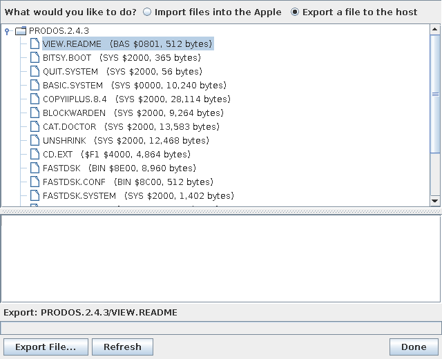
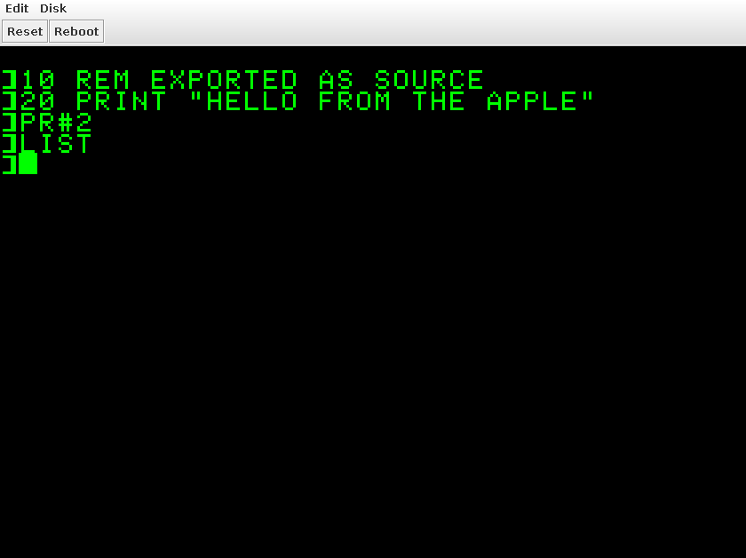
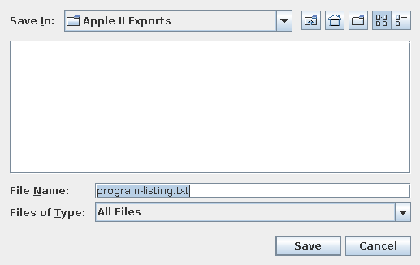

# Host File Transfer Card -- Design

A peripheral card, invented for this emulator, that moves files between
the host and the Apple II's own disks, and captures BASIC program
listings as host text files. Not period hardware: this document describes it, the way
HARDWARE-REFERENCE.md records real cards.

## 1. Principles

- **The guest OS owns its disks.** The emulator never reads or writes a
  file system inside a disk image. Every guest file operation is a real
  call into the guest OS, made by guest code.
- **The emulator knows no guest OS.** It defines an abstract file API
  and drives the whole transfer -- host dialogs, naming, conversions,
  errors -- through it. It never sees an OS call number, a parameter
  list, or a guest memory address.
- **The firmware is an adapter.** The card's firmware implements the
  abstract API for whichever OS is running: ProDOS through its Machine
  Language Interface (MLI), DOS 3.3 through its file manager. Adding an
  OS means adding an adapter, not changing the emulator.
- **The software ships with the card.** Nothing for the user to obtain.
- **Same on every platform**: macOS, Windows, Linux, and Android under
  Termux/PRoot (shared storage at `/sdcard/...` is readable and
  writable there).

## 2. Configuration

```
[2]
type=hostfiles
```

Any slot 1-7, one card per machine. An optional `dir=` sets the folder
the host dialogs open in when none has been used yet.

## 3. User flow

1. From BASIC, the user types `IN#n` (n = the card's slot). The Apple
   screen shows a one-line status in 40 columns, e.g.
   `HOST TRANSFER: PRODOS 2.4` -- the work happens on the host.
2. The emulator opens the transfer window. It first asks for the action
   -- **Import files into the Apple** or **Export a file to the host** --
   and until one is chosen, the tree of the Apple's volumes and
   directories, or DOS 3.3 drives (built by asking the adapter,
   `VOLUMES` and `LIST`), is inactive. A status line above the buttons
   always says what the action will apply to, and the one action button
   is enabled only when it can act.
   - **Export:** select one file in the tree; **Export File...** reads it,
     then opens a save dialog suggesting its host name (section 4.4) in
     the last folder used -- any folder, a new one included, and any
     name will do. Reading comes first because the name can depend on
     it: a DOS 3.3 B file's load address arrives with READ. Export is one
     file per request.
   - **Import:** select the volume or folder to import into -- or a file,
     meaning the folder it's in; **Choose Host Files to Import...** first
     checks the destination (`CHECK_WRITABLE`) -- an empty drive or a
     write-protected disk is explained before anything is chosen -- then
     asks for the host files, and shows their suggested Apple names,
     which follow the guest's rules (reported by the adapter) and can be
     edited.
   - Existing files are replaced only on confirmation; progress and any
     errors appear in the window.
3. **Done** (or closing the window) ends the session: the adapter
   restores borrowed memory and returns to BASIC with normal input, as if
   `IN#0` had been typed, and keyboard focus returns to the Apple's
   window.

### 3.1 How a session starts -- within the hardware model

Every step is either the guest running code or the card reacting to its
own registers; the emulator never moves the program counter, writes
guest RAM, or interrupts the guest.

1. **The guest starts it.** `IN#n` (or `CALL` to the card's entry)
   makes the 6502 run the card's ROM through the ordinary slot
   mechanism, as with any real card.
2. **The firmware announces itself.** After detecting the OS, it writes
   "begin session" to the command register, then its `DESCRIBE` reply
   (protocol version, capability record).
3. **The card tells the host side.** That write runs the card's Java
   code on the emulation thread. The card passes the capabilities to a
   `TransferHost` interface it was given at startup and returns at once.
4. **The window opens on the UI thread.** The application's
   `TransferHost` schedules the transfer window with `invokeLater`; the
   emulation thread never waits on the UI.
5. **Requests flow back** through the card's queue, which the firmware
   polls; while the user is in a dialog it simply keeps polling.
6. **The session ends** with `END` or abandonment (5.1); the card tells
   `TransferHost`, which closes or updates the window.

The card never references Swing: it knows only `TransferHost`, wired by
the application as the VideoTerm's views are. Tests supply a scripted
`TransferHost`, so the whole protocol runs headless. With no host UI
present, the card's status register says so; the firmware prints a
message and returns without starting a session.

Interrupts are deliberately not used to start a session: on a II+ the
interrupt vector belongs to the running software, ProDOS halts on an
interrupt no handler claims, and under DOS 3.3 the vector is whatever
is there.



## 4. The abstract API

Defined by the emulator, implemented by each adapter.

### 4.1 Requests

| Request | Arguments | Reply |
|---|---|---|
| `DESCRIBE` | -- | capability record (4.3) |
| `VOLUMES` | -- | list of containers at the top level: volumes or drives |
| `LIST` | container path | entries: name, kind (file or directory), type tag, aux value, attributes, size |
| `READ` | file path | the file's bytes, streamed |
| `WRITE` | file path, type tag, aux value, attributes | creates the file; bytes streamed in |
| `MAKE_DIR` | directory path | -- (only when hierarchical) |
| `DELETE` | file path | -- (to replace an existing file, after confirmation) |
| `CHECK_WRITABLE` | container path | -- if files can be written there: its disk present, readable, unprotected; else why not (`WRITE_PROTECTED`, `NOT_FOUND`, `IO_ERROR`) |
| `END` | -- | restore memory, return to BASIC |

Paths are sequences of name components -- the adapter, not the
emulator, turns them into `/VOL/DIR/FILE` or a DOS drive and name.

### 4.2 Results

`OK`, `NOT_FOUND`, `EXISTS`, `DISK_FULL`, `WRITE_PROTECTED`,
`BAD_NAME`, `IO_ERROR`, or `OTHER` carrying the OS's own error code and
an optional message for display.

The emulator also has to cope with a request that never completes --
see 5.1.

### 4.3 Capability record

What the emulator needs to do its job without knowing the OS.

**Encoding: extensible.** The record is a sequence of tagged,
length-prefixed fields; a reader skips fields it doesn't know. New
fields can therefore be added later -- for an OS not yet supported --
without changing anything that reads the record today. The fields
defined now are the ones ProDOS and DOS 3.3 need; the CP/M column below
is the basis for the CP/M adapter (section 8).

| Field | ProDOS | DOS 3.3 | CP/M (future) |
|---|---|---|---|
| display name, version | ProDOS 2.4 | DOS 3.3 | CP/M 2.2 |
| structure | hierarchical | flat, per drive | flat, per drive and user area |
| name rules | 15 chars, letter first, letters/digits/`.`, upper case | 30 chars, most printable characters, upper case | 8 + 3, upper case |
| text line ending | CR | CR | CR LF |
| text high bit | clear | set | clear |
| text end marker | -- | -- | `^Z` |
| size granularity | byte | byte | 128-byte record |
| file types | tag + aux | tag (T/I/A/B/S/R) + load address for B | none |
| attributes | access bits (locked etc.) | locked flag | read-only, system |
| default attributes | unlocked | unlocked | none set |
| *future:* pad byte for partial records | -- | -- | `$1A` |
| *future:* two-part names, forbidden characters | -- | -- | 8 + 3, `< > . , ; : = ? * [ ]` |

Rows are the adapters' declarations, not emulator code: the emulator
only applies whatever a record says. Rows marked *future* are fields
that would be added with an adapter that needs them; under CP/M they
mean an exported binary always comes out a whole number of 128-byte
records -- CP/M doesn't store exact lengths, so none can be preserved.

### 4.4 Types and attributes are opaque

An adapter reports each file's type as a short **tag** and an **aux
value** (e.g. `BIN` and `$2000` under ProDOS, `B` and its load address
under DOS 3.3), and its **attributes** as one opaque byte (e.g.
ProDOS's access bits, DOS 3.3's lock flag). The emulator never
interprets any of them: it encodes them in the host file name on export
and passes them back on import, so round trips are lossless.

**The host naming convention.** It outlives every other choice here --
files already exported must keep importing faithfully -- so it doesn't
change:

```
NAME[#tag,aux[,attr]][.TXT]
```

- `#tag,aux` -- type tag and aux value in hex, e.g. `GAME#BIN,2000`.
- `,attr` -- the attribute byte in hex, present only when it differs
  from the adapter's declared default, e.g. `GAME#BIN,2000,21`.
- `.TXT` -- the file is text, converted for the host. A text file with
  default type and attributes is just `NAME.TXT`.
- Every character used is legal on Windows, macOS and Linux.
- Importing a host file with no type in its name: the adapter's
  declared default for text (if the file is valid text) or binary,
  with default attributes.

### 4.5 Conversions, driven by capabilities

Applied by the emulator, only to files whose tag the adapter marks as
text, and only for sequential files -- random-access text files, whose
records are addressed by byte position, are copied unchanged; the
adapter declares how to recognize them (capability `$0D`):

- line endings: the capability record's, to and from the host's (LF;
  CR LF and lone CR accepted on import);
- high bit: set or clear as the record says;
- *future:* end marker and size granularity, for an OS that needs them.

Everything else is byte-for-byte. Format details inside a file, such
as DOS 3.3's load-address header on B files, are the adapter's
business: the API always carries plain data.

## 5. Transport: the card's registers

CPU-neutral: whichever processor runs the adapter (the 6502 today, a
Z80 under a CP/M card some day) talks to the same registers.

| Offset (`$C0n0`+) | Read | Write |
|---|---|---|
| `$0` | request register: next request opcode, or `0` = none yet | -- |
| `$1` | -- | result register: completes the current request |
| `$2` | data port: next byte from the emulator | data port: next byte to the emulator |
| `$3` | card signature / protocol version | ROM bank select (`$C800`-`$CFFF`) |
| `$E` | 6850 status: CP/M's reader (8.2) | 6850 control |
| `$F` | 6850 data: the next reader byte | 6850 data: discarded |

- **Requests and replies** are byte streams through the data port:
  strings as a length byte plus characters, numbers little-endian.
- **The adapter polls.** It loops reading the request register; `0`
  means the user is still busy in a host dialog. The emulation thread
  never blocks; requests reach the card from the host UI thread through
  a thread-safe queue.
- **No DMA.** The emulator never touches guest RAM. Everything,
  including file data, crosses the data port. A tight 6502 copy loop
  moves a 64K file in about a second of emulated time.
- **Protocol version.** Register `$3` reads back the card's signature
  and protocol version, and the adapter states the version it speaks in
  its `DESCRIBE` reply; each side uses only what both support.

### 5.1 When the adapter goes away

A request can be left outstanding with no adapter to finish it: the
user presses RESET or Reboot mid-transfer, or (under CP/M 2.2) an OS
reacts to a disk error by ending the running program rather than
returning an error code. The card must never wait forever:

- **RESET:** the card abandons the transfer session at once. This needs
  a small addition to the card interface -- `SlotCard.onReset()`, a
  default no-op, called when the RESET line is asserted (on real
  hardware, the slot connector carries RESET to every card).
- **Reboot:** builds a new machine with a new card, so the session
  ends with the old card.
- **Silence:** if the adapter neither completes the request nor polls
  for 10 seconds, the host window says the Apple stopped responding and
  offers to keep waiting or cancel. Cancel closes the window; the guest
  stays stuck until RESET, which the message suggests.

In each case the host window reports which files completed and which
didn't. The emulator never retries a write on its own: a partly
written file is reported, and the guest OS's own tools decide what
happens to it.

### 5.2 Wire format (protocol version 1)

**Registers** (offset from `$C0n0`):

| Offset | Read | Write |
|---|---|---|
| `$0` | next request opcode; `0` = none yet; `END` whenever no session is open. Reading a request makes its arguments readable on `$2` | -- |
| `$1` | -- | completion code: ends the message the adapter just wrote to `$2` |
| `$2` | next byte of the current request's arguments (or of recalled memory); `0` once exhausted | next byte of the adapter's message |
| `$3` | bits 0-6: protocol version; bit 7: a host transfer window is available | ROM bank select |
| `$4` | -- | the next character of a captured listing (`PR#n`, section 7) |
| `$5` | where the firmware has got to in typing `LIST`, plus one; 0 = not typing | the same (section 7) |
| `$6` | the listing capture's phase: 0 idle, 1 typing, 2 capturing | the same (section 7) |
| `$7` | -- | trim the capture to its non-blank lines (section 7) |

**Adapter-initiated messages** -- bytes written to `$2`, then the code to `$1`:

| Code | Message | Payload |
|---|---|---|
| `$80` | BEGIN | protocol version spoken (1 byte), then the capability record |
| `$81` | STASH | borrowed memory to keep (opaque, any length) |
| `$82` | RECALL | none; the stashed bytes become readable on `$2` |

**Requests** (card to adapter) and their arguments:

| Opcode | Request | Arguments | Reply payload (with code `$00`) |
|---|---|---|---|
| `$01` | VOLUMES | -- | names, each a string; then an empty string |
| `$02` | LIST | path | entries; then an empty string |
| `$03` | READ | path | a flag byte -- 1 if a type follows: tag, aux -- then the file's bytes |
| `$04` | WRITE | path, tag, aux, attr, size, then `size` data bytes | -- |
| `$05` | MAKE_DIR | path | -- |
| `$06` | DELETE | path | -- |
| `$07` | END | -- | -- (session over) |
| `$08` | CHECK_WRITABLE | path | -- |

**Completion codes `$00`-`$7F`** end a request: `$00` OK, `$01`
NOT_FOUND, `$02` EXISTS, `$03` DISK_FULL, `$04` WRITE_PROTECTED, `$05`
BAD_NAME, `$06` IO_ERROR, `$07` OTHER (payload: the OS's own code, 1
byte, then a message string).

**Encodings:** a *string* is a length byte and that many bytes; a
*path* is a count byte and that many strings; *tag* is a string; *aux*
is 2 bytes, *size* 4 bytes, little-endian; *attr* is 1 byte. A list
*entry* is: name (string, never empty), kind, tag, aux, attr, size.
*Kind* is bits: `$01` directory; `$40` size approximate; `$80` aux value
not known until the file is read.

**Adapters read only what a request needs.** A listing reads directory
or catalog structures, nothing inside files. Where that leaves an aux
value unknown -- a DOS 3.3 B file's load address is in its first data
sector -- the entry says so (`$80`), and READ, which reads the file
anyway, sends the type with flag 1. The emulator names an exported file
from READ's type when one comes, else from the listing's.

**Capability record:** fields of tag (1 byte), length (1 byte), value;
ended by tag `$00`. Readers skip unknown tags.

| Tag | Field | Value |
|---|---|---|
| `$01` | OS name | string bytes |
| `$02` | OS version | string bytes |
| `$03` | structure | 0 = flat, 1 = hierarchical |
| `$04` | maximum name length | 1 byte |
| `$05` | name rules | bit 0: upper case only; bit 1: must start with a letter |
| `$06` | allowed non-alphanumeric name characters | the characters |
| `$07` | text line ending | the byte sequence |
| `$08` | text high bit | 0 = clear, 1 = set |
| `$09` | tags that mean text | strings |
| `$0A` | default type for text files | tag (string), aux (2 bytes) |
| `$0B` | default type for other files | tag (string), aux (2 bytes) |
| `$0C` | default attributes | 1 byte |
| `$0D` | text aux is a record length | 1 = a text file with a non-zero aux value is random-access, and is never converted |

**Host names** -- the convention of 4.4, plus one rule: characters not
legal in host file names on every platform (`/ \ : * ? " < > |`,
control characters), the convention's own `#` and `%`, and a trailing
space or period are written as `%` and two hex digits, and decoded on
import.

## 6. Firmware (the ProDOS and DOS 3.3 adapters)

### 6.1 Build and ROM layout

The source is `firmware/hostfiles/hostfiles.s`, assembled with ca65 and
laid out by `hostfiles.cfg` with ld65 (cc65 suite; macOS, Windows,
Linux). The assembled image is committed as a resource, so building the
emulator needs no 6502 toolchain; `./gradlew assembleHostFilesFirmware`
rebuilds it.

- **The `$Cn00` page:** entry, the listing path, the input entry used
  while typing `LIST`, the copy routine and finish. Position-independent: it runs at `$C100`-`$C700` depending on
  the slot. Its first bytes match neither the Autostart ROM's disk-boot
  signature nor Pascal 1.1's; bytes 5 and 7 (`$18`/`$38`) identify it as
  an Apple Communications Card, for CP/M (8.2).
- **Bank 0** (`$C800`): detection, borrowing memory, messages, and
  capturing a listing (section 7).
- **Bank 1:** the ProDOS agent image. **Banks 2-3:** the DOS 3.3 agent
  image, larger than one bank -- the copy routine follows an image from
  `$CFFF` on to `$C800` of the next bank (reading `$CFFF` releases the ROM,
  but every fetch from the `$Cn` page selects it again).
- Both agents run at `$0800` and begin with the same header -- finish
  pointer, slot, entry -- so the main code can start either.

### 6.2 Entry

`$Cn00` is called as the output device (`PR#n`, with a character to
print) or the input device (`IN#n`). The firmware saves the registers,
finds its slot (`JSR $FF58`, the return address's high byte) and records
it in `MSLOT` (`$07F8`). Then:

- **`CSW` points at the card:** output for a listing capture (section 7).
- **Otherwise:** start a session. The Monitor's RDKEY flashed the cursor
  before calling the input device, so the character under it is put back
  first; then the firmware touches `$CFFF` and jumps to `$C800`.

### 6.3 OS detection

ProDOS first, then DOS 3.3:

- **ProDOS:** `$BF00` holds `JMP` (`$4C`), the MLI entry point in the
  system global page (ProDOS 8 Technical Reference, 5.2.4). Under
  ProDOS 2.4.3: `$BF00: 4C B7 BF`, `MACHID` (`$BF98`) = `$60` (II+, 64K),
  `KVERSION` (`$BFFF`) = `$24`.
- **DOS 3.3:** the page-3 file manager vectors (*Beneath Apple DOS*,
  ch. 5-6). Under the DOS 3.3 System Master: `$3D6: 4C FD AA` (`JMP` to
  the file manager) and `$3DC: AD 0F 9D AC 0E 9D 60` (`LDA $9D0F / LDY
  $9D0E / RTS`: parameter-list address, high in A, low in Y). DOS keeps
  its own code at `$BF00` (`D3`), so it never looks like ProDOS.
- Under ProDOS, page 3 can hold anything -- RAM powers up random -- so DOS
  is recognized by the whole `$3DC` routine shape plus the `JMP` at
  `$3D6`, never by a single byte.

### 6.4 Memory

- **Borrowed, then restored:** `$0800`-`$1BFF` and zero page `$06`-`$09`
  are streamed out to the card before use and back at the end, so memory
  -- a BASIC program included -- is left exactly as it was. Agent code
  runs from `$0800` (up to `$15FF`); the ProDOS agent's I/O buffer is at
  `$1000` and its data buffer at `$1400`; the DOS agent's buffers are at
  `$1600`-`$1BFF`; while an agent is copied, the copy's own variables sit
  at `$1BFB`-`$1BFF`, outside every agent's destination.
- **Under ProDOS** the region is used only if the memory bit map
  (`$BF58`-`$BF6F`) marks pages `$08`-`$1B` free -- ProDOS refuses buffers
  in protected pages; under BASIC.SYSTEM they are free. Otherwise the
  firmware says so and does nothing.
- **OS calls run from RAM.** The ProDOS manual states that MLI calls
  can't be executed from the Language Card area, and while the OS works,
  other cards' firmware can take over the shared `$C800` space. So code
  running at `$C800` calls nothing but COUT1 (`$FDF0`), which touches no
  card, and touches `$CFFF` before running there; all OS calls and all
  printing during a session come from the agent in RAM.

### 6.5 The ProDOS adapter

- **Calls:** CREATE (`$C0`), OPEN (`$C8`), READ (`$CA`), WRITE (`$CB`),
  CLOSE (`$CC`), GET_FILE_INFO (`$C4`), SET_FILE_INFO (`$C3`), DESTROY
  (`$C1`), ON_LINE (`$C5`) -- `JSR $BF00`, call byte, parameter-list
  pointer; carry set and A = error code on failure (Technical Reference,
  ch. 4).
- **LIST** reads directory files; their entries give exact sizes and aux
  values. **READ** sends flag 0: the listing's type stands.
- **Attributes** are the access byte: files are created writable and
  given their requested access afterwards (GET_FILE_INFO, then
  SET_FILE_INFO).
- **CHECK_WRITABLE:** GET_FILE_INFO on the path (a missing volume or
  directory fails here), then the volume's unit from ON_LINE, and its
  block 2 read (READ_BLOCK, `$80`) and written back unchanged
  (WRITE_BLOCK, `$81`) -- a protected disk refuses with `$2B`.

### 6.6 The DOS 3.3 adapter

- **Containers are drives,** `S6,D1` and so on, for each slot whose ROM
  page carries the Disk II signature. The scan touches `$CFFF` before
  reading each page, so it never leaves two cards selected at once.
- **LIST reads only the catalog,** through RWTS (`$3E3`/`$3D9`,
  documented by Apple) -- the file manager's CATALOG call only prints,
  and the output device would be this card. Sizes are sectors x 256,
  marked approximate; a B file's load address, in its first data sector,
  is marked unknown and sent by READ, which reads that sector anyway to
  strip the header.
- **READ and WRITE use the file manager** (`$3DC`/`$3D6`) with the
  agent's own buffers, and carry plain data: the adapter strips and adds
  DOS's headers (B: load address and length; A, I: length). Text is read
  to its first `$00`. Locked files get a LOCK call after CLOSE. Apple
  never published this interface, but its vectors and parameter-list
  format are unchanged across DOS versions, and Apple's FID uses it.
- **CHECK_WRITABLE:** the VTOC read through RWTS (an empty or unreadable
  drive fails here), then written back unchanged -- RWTS refuses a
  protected disk with return code `$10`.
- **From *Beneath Apple DOS*, checked against DOS:** a WRITE range length
  is one less than the byte count; OPEN with X = 0 answers "file not
  found" even as it creates the file; and chapter 6's OPEN list has types
  `$08` and `$10` swapped -- DOS's own CATALOG code (`$ADE8`, indexing its
  `TIABSRAB` table by bit position) and chapter 4 agree that `$08` is S
  and `$10` is R.

### 6.7 Ending a session

- **Input goes back to the keyboard** the way the running OS needs:
  `KSW` (`$38`), plus BASIC.SYSTEM's `VECTIN` (`$BE32`) under ProDOS, back
  to KEYIN (`$FD1B`) -- BASIC.SYSTEM keeps the device in `KSW` too, and
  would call the card again otherwise; under DOS 3.3, `KSW` and then `JSR
  $3EA`, so DOS reconnects its hooks exactly as a DOS that never saw the
  card has them.
- **Then input resumes at a fresh prompt:** BASIC printed its prompt
  before calling the card, and the session's title moved the cursor off
  that line, so the firmware starts a new line and prints the prompt
  character (`$33`) again; then it flashes the cursor, as RDKEY does, and
  continues into KEYIN -- as if the card had never been asked.
- **Early exits** print one line and end the same way: no host window,
  memory in use, or neither ProDOS nor DOS 3.3.

## 7. Capturing the program listing: `PR#n`

`PR#n` captures the BASIC program's listing -- its source -- as a host
text file. `IN#n` starts a transfer session; the firmware tells the two
apart the way real cards did, by checking whether the output vector
(`CSW`) points at it.

- **Output stays on the card, where `PR#n` put it, and the card types
  `LIST`.** When `PR#n` has just been typed, BASIC's next output
  character reaches the card in phase 0. If BASIC's prompt is showing --
  the Monitor's prompt character at `$33` is `]` (Applesoft, under ProDOS
  or DOS 3.3) or `>` (Integer BASIC) -- the firmware makes the card the
  input device and types `LIST` on the following keyboard reads, exactly
  as a real input card supplies typing. Anywhere else, there's nothing to
  list, and output simply goes back to the screen.
- **Only the listing is captured.** While the card types (phase 1), the
  echo of what it types goes to the screen; the echo of its Return starts
  the capture (phase 2). After the listing, BASIC starts its prompt on a
  fresh line -- still to the card -- and waits for a key; at that keyboard
  read the capture is over: the card trims it to its non-blank lines
  (register `$7`) -- removing Applesoft's leading blank line, and BASIC's
  fresh line and prompt -- output and input go back to the screen and
  keyboard, and the prompt is printed on the screen, where it belongs.
  Spaces within lines stay: Integer BASIC's right-align its line numbers.
- **Its own input entry.** While the card types, output and input both
  point at the card, so `$Cn00` couldn't tell a character to print from a
  keyboard read. The firmware points the input vector at a separate entry
  in its `$Cn00` page instead, set the way the running OS needs: under
  ProDOS BASIC.SYSTEM's `VECTIN` as well as `KSW`, under DOS 3.3 `KSW` and
  then `JSR $3EA`.
- **Its state lives on the card:** registers `$5` (the place in `LIST`)
  and `$6` (the phase), because Apple II RAM powers up random -- a flag in
  RAM would often read "capturing" after a cold start. The card's
  registers are 0 at power-on and cleared by RESET.
- **The cursor:** the Monitor's RDKEY flashes the cursor before calling
  the input device, and expects the original character put back. Each
  typed character puts back the character under the cursor, as KEYIN
  does.
- **The listing path** is a few instructions in the `$Cn00` page: in
  phase 2 the character goes to register `$4` and nowhere else -- no
  echo, the screen cursor never moves (see below), nothing borrowed --
  and every register is kept.
- **Saving:** the listing collects in the card's spool; once nothing has
  arrived for 1.5 seconds, a dialog, **Save Program Listing**, asks for
  the host file's name and folder, opening in the last folder used, else
  the card's `dir=` folder.
- **Conversion:** clear bit 7, CR to LF. The listing is screen output,
  the same for every OS and BASIC, so no capability record is involved.





**Why the listing path never moves the cursor.** `LIST` breaks long lines
by the screen cursor's column, so with echo the exported source would be
corrupt:

| | Applesoft | Integer BASIC |
|---|---|---|
| cursor doesn't move | every line intact, however long | every line intact, however long |
| cursor moves (echo) | breaks past column 33, mid-string; the indent is a cursor move, so the text gets a bare break | breaks near column 38 and prints real spaces to indent, putting spaces inside string literals |
| line format | `10  PRINT ...`: two spaces after the number, spaces around keywords | `   10 PRINT ...`: number right-aligned in 5, statements as typed |
| characters | bit 7 set, CR line ends | bit 7 set, CR line ends |

**Loading source back:** import the file as a text file through `IN#n`,
then `NEW` and `EXEC` it -- DOS 3.3 and BASIC.SYSTEM both read it as if
typed, and the program rebuilt is identical. The export is each BASIC's
own rendering of the stored program, not the original keystrokes; typed
back in, it rebuilds the same program.

## 8. CP/M, for the Microsoft SoftCard II

Designed, not built. The SoftCard II is emulated by the separate
[SoftCard2](https://github.com/sbabcoc/SoftCard2) project, whose
`HARDWARE-REFERENCE.md` documents the card and the command protocol
between its Z80 and the 6502. The addresses below come from the
SoftCard II CP/M 2.28B master disk (64K), read from its code and
confirmed by running it unless marked otherwise.

### 8.1 How the Z80 reaches this card

The SoftCard II's Z80 runs from its own 64K and can't address the
Apple's I/O space. Everything it does on the Apple side goes through
commands to CP/M's 6502-side server -- and two of those commands are
generic memory access:

- **Command 1** reads any 6502 address; **command 2** writes one. Both
  reach I/O space: command 2 throws soft switches as readily as it
  writes RAM.
- The Z80 BIOS exposes all the commands through one entry, which every
  warm boot publishes as a jump at `$0040` -- the way CP/M publishes
  BDOS at `$0005`. A caller puts the command number in `$0049`, an
  address in `$004A`/`$004B` (low byte first), and for these two
  commands the byte written, or the byte read back, in `$0045`, then
  calls `$0040`.

So a CP/M adapter is Z80 code that uses this card's registers (section
5) one access at a time through commands 1 and 2. The path -- Z80
adapter, SoftCard II mailbox, 6502 server, this card -- needs no new
6502 code and no change to the SoftCard II: the server already relays.
Each register access costs one command over the mailbox, so transfers
are slower than the 6502 adapters' copy loops.

Calling through `$0040` means the adapter never hard-codes where the
BIOS is; in this 64K system the jump leads to `$FBA0`. The interface was
found in the running system rather than in documentation. A SoftCard II
*Programmer's Manual* exists (Trailing Edge hosts a scan) and may
document it; the adapter should be checked against it.

### 8.2 Delivering the adapter: the card as CP/M's reader

"The software ships with the card" holds under CP/M too: the card
supplies its own Z80 adapter, and CP/M's own programs write it to disk.

- **CP/M's reader is slot 2.** CP/M boots with IOBYTE `$95`, which
  assigns `RDR:` to `PTR:` and `PUN:` to `PTP:`. The BIOS serves both
  with slot 2: reader input as command 5, punch output as command 6.
  (`LST:` goes to slot 1.) The card therefore goes in slot 2.
- **The card presents a 6850 serial interface** (the Apple
  Communications Card's identity), so the server reads and writes it
  with no firmware involved:
  - identification bytes `$Cn05` = `$18`, `$Cn07` = `$38`;
  - `$C0nE` read: status -- bit 0 receive register full, bit 1 transmit
    register empty; write: control (the server writes `$03`, master
    reset, then `$15` at startup);
  - `$C0nF` read: received byte; write: byte to transmit.

  These registers sit beside the protocol registers at `$C0n0`-`$C0n7`.
  The server's input routine waits on bit 0 and its output routine on
  bit 1, so the card keeps bit 1 set and, when it has nothing else to
  send, offers `^Z` (end of file) rather than leaving a reader read
  waiting forever.
- **The reader delivers the adapter**, as Intel HEX ending in `^Z`. On
  the master disk's own programs:

  ```
  A>PIP XFER.HEX=RDR:
  A>LOAD XFER
  ```

  The reader starts the adapter over after each `^Z`, and whenever the
  6850 is master-reset -- which the server does at every CP/M cold boot
  -- so every `PIP` from the reader gets a complete copy, even after one
  was interrupted. A truncated copy that slipped through anyway would
  fail LOAD's checksums rather than produce a bad `XFER.COM`.

  Punch output is accepted and discarded.
- **The `$Cn00` entry carries the identification** as instructions:
  bytes 5 and 7 are `CLC` (`$18`) and `SEC` (`$38`), as on the
  Communications Card, executed harmlessly after the entry's register
  pushes, so `IN#n` and `PR#n` behave as before under ProDOS and DOS 3.3.
- A side effect: the CP/M loader probes only empty or unrecognized
  slots when it looks for the SoftCard II, so a recognized serial card is
  never probed.

This path has run end to end: SoftCard2's `XferDeliveryTest` boots the
master disk with this card in slot 2, delivers a placeholder adapter
with `PIP` and `LOAD`, and runs it.

### 8.3 The adapter

`XFER.COM`, run from the CCP, plays the part of `IN#n`: it begins the
session, sends `DESCRIBE`, and polls the request register, all through
commands 1 and 2. It implements section 4.1 with BDOS calls, so the
guest OS still owns its disks:

| Request | CP/M |
|---|---|
| `VOLUMES` | the drives present, each divided into its user areas (below) |
| `LIST` | directory search (BDOS 17/18) within a drive and user area |
| `READ` | open, sequential read by 128-byte record |
| `WRITE` | make, sequential write, close |
| `DELETE` | delete (BDOS 19) |
| `CHECK_WRITABLE` | the drive selects, and isn't read-only (BDOS 29) |
| `MAKE_DIR` | not offered -- CP/M isn't hierarchical |
| `END` | return to the CCP |

It runs in the TPA, so nothing is borrowed or restored.

**Which drives exist** comes from the BIOS, not BDOS: asking BDOS to
select a drive that isn't there stops with `Bdos Err On d: Select`. The
adapter calls the BIOS's `SELDSK` entry through its jump table (the
table's address follows from the warm-boot vector at `$0001`), which
returns 0 for a drive beyond those present -- in this BIOS, past the
drive count it keeps at `$F3B8`, 2 with one Disk II controller. It then
reselects the current drive through BDOS, so BDOS and the BIOS agree
again.

**User areas.** CP/M 2.2 divides each drive's directory into sixteen
numbered *user areas*, 0 to 15: separate sets of file names on the same
disk, chosen with the CCP's `USER n` command; area 0 is the default, and
most disks use nothing else. Each drive appears with area 0 and any
other area that holds files, each as a flat container (`A0:`, `A3:`,
...).

### 8.4 The file model

The CP/M column of the capability record (4.3) applies, and its fields
marked *future* become real: the record pad byte (`$1A`), two-part names
with their forbidden characters, the `^Z` end marker, and 128-byte size
granularity. The record's tagged encoding takes the new fields without
disturbing the ProDOS and DOS 3.3 adapters; the emulator gains the
conversions in 4.5 that it already lists as future.

**Which files are text.** CP/M files carry no type, so the extension
supplies a default, and the user can override it for each file, in
either direction. Text by default:

| Extensions | Contents |
|---|---|
| `ASM`, `MAC`, `LIB` | assembler sources and macro libraries |
| `PRN`, `SYM` | assembler listings and symbol tables |
| `HEX` | Intel HEX |
| `SUB` | SUBMIT command files |
| `DOC`, `TXT`, `ME` | documents (`READ.ME`) |
| `FOR`, `COB`, `PAS`, `C`, `H` | compiler sources |
| `BAK` | ED's backup of an edited text file |

Everything else defaults to binary. That includes `BAS`: BASIC-80 saves
programs tokenized unless told `,A`, so an ASCII-saved program is
exported as text by override. Conversions (4.5) apply to the files
treated as text.

**Importing a name CP/M can't hold.** A CP/M name is up to 8 characters,
optionally a dot and up to 3 more, without spaces or any of
`< > . , ; : = ? * [ ]`. Lowercase is converted to uppercase, as the CCP
does. Any other host name that doesn't fit -- too long, or with a
forbidden character -- isn't shortened or altered: the transfer window
asks the user for a target name, and checks it against the same rules.

**Host names** follow 4.4 unchanged: a file exported as text gains
`.TXT`, so `READ.ME` becomes `READ.ME.TXT` and `PROG.ASM` becomes
`PROG.ASM.TXT`; a binary keeps its CP/M name. CP/M has no type tags or
attributes to record, so `#tag,aux` never appears. On import, `.TXT`
marks text as it does for ProDOS and DOS 3.3, and the CP/M name is what
remains.

BASIC-80 programs need no counterpart to `PR#n` (section 7): `SAVE
"NAME",A` writes the program as text, which exports like any other file.

### 8.5 Starting a session from the menu

Under ProDOS and DOS 3.3 the user starts a session by typing `IN#n`.
Under CP/M a single menu item, **File > Start CP/M Transfer**, does
everything:
it starts the adapter, installing it first if the disk lacks it. It
works only through the keyboard and what the screen shows -- the same
`TypingFeeder` behind the Edit menu's **Paste**, and the console's text
(`VideoTermRenderer.text` for the VideoTerm) -- so the guest still runs
every program and writes every file itself.

**Knowing CP/M is running.** The card can tell without asking the guest:
at every cold boot, CP/M's 6502 server initializes each serial card by
master-resetting its 6850 (`$03` to the control register, then `$15`).
The menu item is enabled once the card has seen that initialization
since the last RESET. Other software that drives a Communications Card
would initialize it the same way; the prompt check below catches that
case.

The application has no File menu yet -- only Edit and Disk -- so this
item creates it, first in the menu bar, ahead of Edit.

This automation is the one place that knows CP/M's commands and their
output. It belongs to the application's UI, beside the transfer window;
the card stays OS-agnostic.

**The sequence.** Rather than checking conditions in advance, it runs
each command and reads what CP/M prints. Every step waits for the CCP
prompt to return before typing the next; nothing is typed ahead.

1. **CP/M is idle at the CCP:** the console's last line is a prompt such
   as `A>`, with nothing typed after it. Otherwise the item explains and
   types nothing.
2. **`^C`** warm-boots CP/M, re-logging its disks. That clears the
   read-only state BDOS gives a disk changed without a warm boot, a
   failure that can be avoided rather than recovered from.
3. **`XFER`.** If the card receives "begin session" within a few
   seconds, the transfer window opens as in section 3, and the sequence
   is done. If the CCP answers `XFER?` -- its reply to a command it can't
   find -- the adapter isn't installed: go on to step 4. If the adapter's
   `DESCRIBE` reports an older protocol version than the card's, the
   session ends at once, `ERA XFER.COM` removes it, and step 4 installs
   the current one.
4. **Install:** `PIP XFER.HEX=RDR:`, `LOAD XFER`, `ERA XFER.HEX`, then
   step 3 again.

**Recognizing failure.** Each command has a known successful result: the
prompt returning with no message, or for LOAD its summary, ending in
`RECORDS WRITTEN nn`:

```
FIRST ADDRESS 0100
LAST  ADDRESS 0132
BYTES READ    0033
RECORDS WRITTEN 01
```

Anything else is a failure, and the item stops and reports it, showing
what CP/M printed:

- `PIP?` or `LOAD?` -- the tool isn't on the current disk.
- An error line from PIP or LOAD, such as a full disk.
- `Bdos Err On d: ...` -- BDOS has stopped and is waiting for a key, so
  the prompt won't return on its own. The item types `^C`, which
  warm-boots CP/M back to the prompt, and reports the reason BDOS gave:
  `R/O` for a write-protected disk, `Bad Sector`, or `Select`.

The exact text of each message is taken from running the cases -- a
missing tool, a write-protected disk, a full disk -- on the SoftCard II
master disk, not written from memory; those runs become the item's
tests.

### 8.6 Testing, and what remains to decide

**The CP/M integration test lives in the SoftCard2 project.** SoftCard2
already depends on this project, so its test can assemble the whole
machine: its CP/M harness gains this card in slot 2, given a
`TransferHost` and driven with `TransferOperations` exactly as
`ProDosTransferIntegrationTest` does here -- all three are public. The
test boots the master disk, runs the menu item's sequence (8.5) through
the harness's keyboard and console, and carries out imports and exports
in both directions. It also provokes each failure 8.5 recognizes, which
is where those messages' exact text comes from.

That puts one requirement on the code here: the menu item's logic must
be a public class independent of Swing, taking a keystroke sink and a
source of console text. The application wires it to `TypingFeeder` and
`VideoTermRenderer`; SoftCard2's test wires it to its harness. This
project's own tests cover what needs no CP/M -- the 6850 registers, the
reader stream and its restarts, and the capability fields.

**Building the Z80 adapter.** The adapter is assembled with sjasmplus
(BSD-licensed; Intel HEX output since version 1.22.0), the same way the
6502 firmware uses ca65: the source is `firmware/xfer/xfer.asm`,
`./gradlew assembleXferAdapter` rebuilds it, and the assembled
`xfer.hex` is committed as a resource of the card, so building the
emulator needs no Z80 toolchain. The reader streams that file as it is,
followed by `^Z`. Its records are data records ascending from `$0100`
and an end record, which LOAD accepts.

**Still to establish:**

- The wire encoding (5.2) of the new capability fields.
- Whether ProDOS or DOS 3.3 treats a card that identifies as a
  Communications Card differently: `ProDosTransferIntegrationTest` and
  `DosTransferIntegrationTest`, run with their system disks, show that
  sessions still work.
- The BIOS's `SELDSK` returning 0 for an absent drive, and the
  reselection afterward, by running them.

## 9. Testing

- **Card and protocol:** unit tests drive the registers with a scripted
  fake adapter -- requests, replies, results, polling while a dialog is
  open -- against a temporary host folder.
- **Emulator logic:** naming, type encoding and conversions tested
  against capability records alone, so nothing depends on a particular
  OS. The host naming convention round-trips every type, aux value and
  attribute byte exactly; capability records with unknown fields are
  read without error.
- **Abandonment:** RESET mid-request ends the session at once; a silent
  adapter triggers the "stopped responding" choice; partial transfers
  are reported, never retried.
- **Adapters:** end-to-end runs in the emulator with real ProDOS 2.4.3
  and real DOS 3.3: import a text file and a binary, check them with the
  guest's own `CATALOG` and `BLOAD`/`LOAD`, export and compare host
  files. The guest OS's own commands are the oracle, not the card.
- **Listing capture:** `PR#2` captures exactly the expected listing under
  the real systems, for Applesoft and Integer BASIC, and captured source
  imported and EXECed rebuilds the same program (`PrintIntegrationTest`).
- **Images:** the integration tests need user-supplied disk images in
  their test resources (`ProDOS_2_4_3.po`, `DOS_3_3_System_Master.woz`,
  `.dsk` or `.po`), and are skipped without them.
